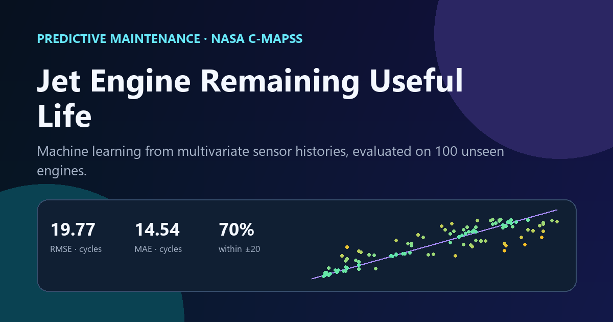

# Predictive Maintenance: Jet Engine Remaining Useful Life

[](https://jhon1217.github.io/jhu-data-science-projects/projects/google-advanced/cmapss/)
[](https://www.python.org/)
[](LICENSE)



## Executive summary

This project estimates the remaining useful life (RUL) of simulated turbofan engines from multivariate sensor histories. The model achieves **19.77 cycles RMSE**, **14.54 cycles MAE**, and places **70% of test predictions within ±20 cycles** on NASA's separate FD001 test fleet.

The result is designed as a prioritization signal: it can help identify engines that warrant earlier inspection while keeping engineering thresholds and maintenance history in the decision.

## Business question

Can recent changes in engine sensor readings estimate how many operating cycles remain before failure?

## Data

- **Source:** [NASA C-MAPSS Jet Engine Simulated Data](https://data.nasa.gov/dataset/cmapss-jet-engine-simulated-data)
- **Subset:** FD001
- **Training data:** 20,631 cycles from 100 engines
- **Test data:** 100 separate engines with NASA-provided RUL targets
- **Scenario:** one operating condition and one fault mode

Raw files are retrieved from NASA when the analysis runs and are intentionally excluded from version control.

## Method

1. Create a capped RUL target for every training cycle.
2. Remove constant sensor channels and rank the remaining signals by absolute Spearman correlation.
3. Add one-cycle change and five-cycle rolling mean features.
4. Hold out the final 20 training engines for development validation.
5. Train a random forest regressor on all training engines.
6. Evaluate once on the official test fleet and publish engine-level diagnostics.

## Results

| Metric | Result |
|---|---:|
| Test RMSE | 19.77 cycles |
| Test MAE | 14.54 cycles |
| Predictions within ±20 cycles | 70% |
| Development holdout R² | 0.786 |

The strongest grouped signals include Sensor 4, Sensor 11, cycle age, Sensor 15, and Sensor 3. Feature importance describes this fitted model; it does not establish a causal failure mechanism.

## Repository structure

```text
.
├── assets/preview.png
├── data/results.json
├── src/analysis.py
├── src/validate_results.py
├── requirements.txt
└── README.md
```

## Reproduce the analysis

```bash
python -m venv .venv
python -m pip install -r requirements.txt
python src/analysis.py
python src/validate_results.py
```

The pipeline uses a fixed random seed. `validate_results.py` checks the published fleet size, prediction records, metric ranges, and source metadata.

## Limitations

- FD001 represents one simulated operating condition and one fault mode.
- Prediction error is asymmetric in real maintenance decisions: a late intervention can cost more than an early one.
- Deployment would require fleet-specific validation, uncertainty thresholds, drift monitoring, and engineering review.

## Interactive result

**[Open the live dashboard](https://jhon1217.github.io/jhu-data-science-projects/projects/google-advanced/cmapss/)** to inspect prediction error, grouped feature importance, and sensor trajectories for individual engines.

## Author

**Jhon Deiner Diaz** · [Data portfolio](https://jhon1217.github.io/jhu-data-science-projects/) · [GitHub](https://github.com/jhon1217)
